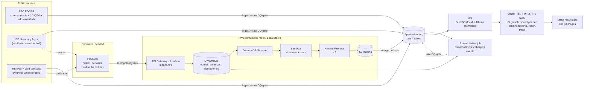

# Broking + cards ledger on AWS (emulated)

[](https://github.com/rohit91jacob/fintech-broking-cards-aws/actions/workflows/ci.yml)
[](https://github.com/rohit91jacob/fintech-broking-cards-aws/actions/workflows/refresh.yml)
[](https://rohit91jacob.github.io/fintech-broking-cards-aws/)
[](LICENSE)
[](DATA_LICENSE.md)


An event-driven, double-entry ledger for a retail **stock broker** (Zerodha / Robinhood style)
and a **credit-card and bill-payments** app (CRED style), built the way it would run on AWS:

**API -> DynamoDB double-entry ledger (idempotency keys, conditional writes) -> DynamoDB
Streams -> Lambda -> Kinesis Data Firehose -> S3 / Apache Iceberg -> dbt (DuckDB locally,
Athena compiled in CI)**, with a reconciliation job proving that ledger balances equal positions,
T+1 settlement, card-fraud rules, and Terraform for the whole stack.

* **Real data where the source allows it.** Robinhood's KPIs and revenue by type from
  **SEC EDGAR** XBRL and filings, downloaded at run time. **NSE** end-of-day prices and **RBI**
  payment statistics (UPI, credit cards outstanding, card spend by bank) are parsed in their
  published file layouts, but neither site serves its files to a client that identifies itself
  honestly, and NSE's Terms of Use prohibit automated collection and the use of its data for
  simulation. The pipeline does not pose as a browser: the NSE download is off by default, a
  refused RBI download is skipped, and both fall back to files already in the raw directory or
  the committed **synthetic** fixtures, which the results site labels as such. See
  [DATA_LICENSE.md](DATA_LICENSE.md#automated-access-what-the-sources-do-with-an-honest-user-agent).
* **Simulated activity, clearly labelled.** Customer orders and card swipes are not public, so
  a seeded simulator generates them: fills at the daily VWAP of the bhavcopy table, card
  spending sized from the RBI table's averages. Every simulated row carries `simulated = true`.
* **Emulated cloud, real code paths.** Every AWS call is a real `boto3` call. Locally and in
  tests it runs on [moto](https://github.com/getmoto/moto) in-process; a CI job runs the same
  code over HTTP against LocalStack (or moto's server). **No AWS account is used anywhere.**
  The Terraform is validated (`fmt`, `validate`, `tflint`, `checkov`), not deployed.
* **Proof.** Robinhood figures match the published earnings releases for every compared metric
  but one (a $322.1 B vs $324 B platform-assets difference between the 10-K and the release);
  the ledger reconciles on 39 + 32 checks; the raw gate fails a run whose NSE window is missing
  any session the exchange calendar expects. See [docs/verification.md](docs/verification.md).

## Results (run of 10 October 2026)

| | |
|---|---|
| Robinhood, Q2 2026 (SEC 10-Q) | **28.4 M** funded customers, **$368.7 B** platform assets, **$21.7 B** net deposits, **$1,308 M** revenue |
| NSE and RBI | **Not downloaded.** The NSE download is off (Terms of Use); the RBI's document server answered with a bot challenge. The run used the synthetic fixtures, so the site's UPI, card and price figures are marked synthetic. |
| Simulated ledger, 28 Sep - 1 Oct 2026 (the fixtures' 4 sessions, synthetic prices) | **2,543** postings, **17** rejected by ledger constraints, **81** idempotent replays, **500** stream records redelivered and de-duplicated; reconciliation **OK** (39 + 32 checks) |
| Full run (`fbc run`, laptop) | 143 s end to end (ingest about 40 s, simulation 86 s, dbt and site the rest); `dbt build`: PASS=78, WARN=1 (`assert_rbi_cards_cross_publication`, expected on the independently generated synthetic workbooks), ERROR=0 |

The UPI and card figures this table showed before (UPI August 2026: 24.51 bn transactions;
124.1 M credit cards) came from the 9 October run of an earlier version that sent a browser
User-Agent to NSE and the RBI. That code is gone; those figures stay in
[docs/verification.md](docs/verification.md) as the record of the parser checks, and this code
cannot reproduce them.

The [results site](https://rohit91jacob.github.io/fintech-broking-cards-aws/) is rebuilt every
weekday evening (IST) by [`refresh.yml`](.github/workflows/refresh.yml).

## Architecture



| Component | What it does | Code |
|---|---|---|
| Sources | SEC companyfacts, XBRL instances (revenue on `srt:ProductOrServiceAxis`), KPI tables; NSE UDiFF bhavcopy and trading calendar; RBI PSI and bank-wise card statistics. Requests carry a descriptive User-Agent; a source that refuses it is skipped (`Refused`), never retried in disguise. | `src/fbc/sources/`, `src/fbc/http.py` |
| Ledger API | API Gateway-style Lambda handler: deposits, orders, T+1 settlements, card authorisations, bill payments, balance reads | `src/fbc/ledger/api.py` |
| Ledger service | One `TransactWriteItems` per posting: idempotency record and journal header + legs (each `attribute_not_exists`, so a posting applies once even after its key has expired), `ADD balance` with conditions (no overdraft, no short sale, credit limit). Replays, rejections and key conflicts are distinguished from the cancellation reasons; transient cancellations (transaction conflicts, throttling) return 503 and write nothing, so a retry with the same key is processed normally. | `src/fbc/ledger/service.py`, `model.py` |
| Stream processor | Lambda for DynamoDB Streams: headers -> business events, legs -> ledger entries, `PutRecordBatch` to two Firehose streams, partial batch failures | `src/fbc/ledger/stream.py` |
| Event source mapping (emulated) | Reads shards, invokes the Lambda in batches, re-delivers 5 % of batches to exercise at-least-once delivery | `StreamPoller` in `stream.py` |
| Iceberg sink | Plays Firehose's Iceberg destination: lands S3 JSON lines into Iceberg, partitioned by `business_date`, merged on `(txn_id, leg_no)` / `txn_id` | `src/fbc/lake/sink.py`, `iceberg.py` |
| Simulator | Seeded customers, cards, orders, card swipes, retries, conflicting keys and four fraud scenarios | `src/fbc/sim/` |
| Reconciliation | Trial balance, DynamoDB vs Iceberg, positions, customer cash, clearing obligations, card balances, constraints | `src/fbc/recon.py` |
| Data quality | Raw gate (11 error + 4 warn checks) after ingest, including a complete NSE window: every session the NSE calendar expects in the requested window, `FBC_NSE_SESSION_TOLERANCE` (default 0) missing at most; lake gate (7 checks) after the pipeline; 55 dbt tests on the models | `src/fbc/quality/checks.py`, `dbt/` |
| dbt | staging -> intermediate -> marts, DuckDB over Iceberg locally, Athena target compiled in CI | `dbt/` |
| Infrastructure | Terraform modules: KMS, DynamoDB, S3 + Glue + Iceberg tables, Firehose (Iceberg destination), Lambda + API Gateway + DLQ, Athena, budgets and alarms, GitHub OIDC | `infra/terraform/` |
| Site | Static HTML with inline SVG charts and table views | `src/fbc/report.py` |

## Tech stack

| Layer | Tool (version in `uv.lock`) |
|---|---|
| Language | Python 3.12, managed by uv |
| AWS SDK / emulator | boto3 1.43, moto 5.2 (in-process and HTTP server), LocalStack 2026.09 (CI, optional) |
| Table format | Apache Iceberg via pyiceberg 0.12 (SQLite catalog, local warehouse) |
| Query / transform | DuckDB 1.5.6, dbt-core 1.12, dbt-duckdb 1.11 (iceberg plugin), dbt-athena 1.11 (compile only) |
| Files | pyarrow 26, openpyxl 3.1, requests 2.34 |
| Infrastructure | Terraform 1.16, AWS provider ~> 6.68, tflint 0.64 + AWS ruleset 0.49, checkov |
| Quality | pytest 9, ruff 0.16, pre-commit, gitleaks |
| CI / scheduling | GitHub Actions, GitHub Pages |

## Design rationale

Five constraints drove the design. **Real data only where the source allows it**: SEC EDGAR
serves a client that identifies itself, so Robinhood's XBRL facts and the KPI tables of its
filings are downloaded at run time. NSE's Terms of Use prohibit automated collection and any use
of its data for simulation or virtual trading, and the RBI's document server answers automated
clients with a bot challenge, so NSE prices and RBI statistics come by default from committed
**synthetic** fixtures in the published layouts; the NSE download is off unless
`FBC_NSE_DOWNLOAD=1`, which is only for someone with NSE's written permission. **Customer
activity is not public**, so it is simulated, seeded and labelled. **Money must be provably
right**: every posting balances, a retried request posts once, and at-least-once delivery may
not lose or double a leg on its way to Iceberg. Everything must **run without an AWS account or
Docker**, the weekday refresh included. And every step must be **safe to rerun**: the same seed
reproduces the ledger counters, lake row counts and marts (`tests/e2e`).

### Architecture decisions

| Decision | Why | Alternatives considered | Trade-off accepted |
|---|---|---|---|
| **One DynamoDB transaction per posting** (`ledger/service.py`). `TransactWriteItems` holds the idempotency record, the journal header and an item per leg (each put with `attribute_not_exists`), and an `ADD balance` per leg, conditioned on constrained accounts (no overdraft, only settled shares sold, credit limit). `Posting.validate` refuses legs that do not sum to zero per unit before anything is sent (`ledger/model.py`) | Journal, balances and idempotency record change together or not at all, so no balance moves without its legs, and each limit is checked against the balance it changes, with no read-then-write race. Shares are a unit (an ISIN) like rupees, so one trial balance covers cash and securities; amounts stay `Decimal` end to end | Separate journal and balance writes (a failure between them leaves the two disagreeing); read, check, then write with a version number per account (an extra round trip and a retry on every busy account); balances summed from the journal on read (a query per check, and no atomic limit) | Every posting touches a shared account (`CCP:*`, `HOUSE:BROKERAGE_FEES` or `EXT:*`), and those items become hot under concurrent load (`modules/guardrails` alarms on `TransactionConflict`); balances are stored, not derived, so reconciliation has to prove them |
| **The idempotency key decides the outcome** (`ledger/service.py`, `ledger/api.py`). `txn_id` is a UUIDv5 of the `Idempotency-Key`, and the key's record and the journal header store a hash of the request. The cancellation reasons separate the cases: a key used before (its record exists or, once that has expired, the journal items under its `txn_id` do) is a replay (200 with the original outcome), the same key with a different body a conflict (409), a failed balance condition a `REJECTED` header with its own idempotency record (422); any other code (transaction conflict, throttling) returns 503 and writes nothing | Apps and the settlement job retry. A retry must get the first answer, a rejection included, and a transient failure must never become the permanent answer for a key. Deterministic ids map a request to the same journal items on every run, so the journal's own conditions refuse a second posting even when the idempotency record is gone | Deduplicating on a client-supplied id alone (a retry and a reused key with a new body look the same); recording every cancellation as a rejection (one throttle would reject a valid request for good); looking the key up before writing (an extra read, and a race between lookup and write) | Idempotency records expire after 30 days (DynamoDB TTL on `expires_at`); a replay costs a consistent read, and a second one once the record has expired (the journal header answers, so the API role may read the journal); LocalStack and moto put the reason codes in the error message, which `_reason_codes` parses |
| **The journal is the outbox: Streams -> Lambda -> Firehose -> Iceberg** (`ledger/stream.py`, `modules/compute`, `modules/streaming`). The journal's stream (`NEW_IMAGE`) feeds one Lambda that ships INSERTs only, headers to the `business-events` Firehose stream and legs to `ledger-entries`, and reports failures by sequence number (`ReportBatchItemFailures`). On AWS, Firehose upserts into Glue Iceberg tables on `unique_keys`; emulators only offer the S3 destination, so `lake/sink.py` merges the landed JSON lines on the same keys, `(txn_id, leg_no)` and `txn_id` | The API makes one write and the events are derived from what committed, so there is no event for a posting that failed and none missing for one that succeeded. Firehose buffers and commits, so no code here holds lake-writing state, and the key merge absorbs redelivery: in the last run 500 records were redelivered and 9,539 landed leg rows merged to 9,127 (`docs/verification.md`) | The API writing to DynamoDB and to a stream or queue (a dual write: lost or phantom events); Kinesis Data Streams for DynamoDB (shards billed by the hour, and records can arrive duplicated or out of order); a Lambda committing to Iceberg itself (a commit per invocation and shard: small files and commit conflicts) | Delivery is at-least-once (the emulated mapping re-delivers 5 % of batches on purpose), so correctness rests on the merge keys; a batch that keeps failing goes to the SQS on-failure queue and is missing from the lake until redriven, which reconciliation reports as a break; locally the sink re-reads every landed object and rewrites each `business_date` partition it touches |
| **Reconciliation across three independent views** (`recon.py`, `mart_ledger_reconciliation`). DynamoDB balances are compared with the legs that reached Iceberg through the stream, per account and unit, and with positions, customer cash, clearing obligations and card balances rebuilt from the business events, besides the trial balance per unit and the limits. Any break stops `fbc simulate` and `fbc run` with exit status 4 before the lake gate (which lists it too) is applied, and `fbc reconcile` exits 4 on the stored results; dbt recomputes the DynamoDB-against-lake comparison in SQL | Transactions prove that each posting balances, not that the stream delivered every leg exactly once or that the event payloads agree with the legs. Views built by different code catch both; the last run passed 39 Python checks and 32 dbt reconciliation rows (`docs/verification.md`) | Trusting the transactions alone (no evidence the lake is complete); dbt tests alone (dbt cannot read DynamoDB, so the job's balance snapshot is needed anyway); comparing row counts (one duplicated and one lost leg still match) | It reads the balances table and both lake tables whole and assumes the ledger has stopped posting, which holds because it runs after the simulation (see below) |
| **Gates between layers, and a complete NSE window** (`quality/checks.py`, `sources/nse_calendar.py`). The raw gate (11 error and 4 warning checks) runs after ingest and before anything is simulated; the lake gate (7 checks, reconciliation included) after the event pipeline; 55 dbt tests on the models. `nse_trading_days` takes the sessions the requested window must hold from NSE's published 2024-2026 holiday list and fails when more than `FBC_NSE_SESSION_TOLERANCE` (default 0) are missing | Fills are priced at each session's VWAP and settle on the next loaded session, so a missing day would shift T+1 dates and P&L without any error; a count of loaded files passes a partial download or a hole in the middle. An error stops the run (exit 3) before the next layer is built | A minimum number of days (passes with gaps); every weekday as a session (fails on each holiday); NSE's holiday API at run time (nseindia.com does not answer this client, and its terms prohibit automated collection); Great Expectations or Soda (a second framework for SQL checks) | The holiday list is kept by hand: outside 2024-2026 every weekday counts as a session (a warning), and a holiday declared at short notice fails the gate until it is added; the synthetic fixtures are a fixed 4-session window, so a fallback run uses all of it whatever `FBC_TRADING_DAYS` asks for |
| **An honest User-Agent; a refusal skips the source** (`http.py`, `ingest.py`). NSE and RBI requests send `fintech-broking-cards-aws/<version> (+repository URL)`, SEC requests `FBC_SEC_USER_AGENT` with a contact e-mail. A challenge page, HTTP 403 or no answer raises `Refused`: ingest records it, skips the source and uses files already in the raw directory, else the committed synthetic fixtures; `runs/ingest_manifest.json` says which, and the site labels those figures synthetic. The NSE download stays off unless `FBC_NSE_DOWNLOAD=1` | SEC asks automated clients to identify themselves; NSE's terms prohibit automated collection and any use of its data for simulation; the RBI's document server serves automated clients a bot challenge. The pipeline takes what is served to a client that says what it is, and a run still completes, because only SEC is required | A browser User-Agent or a headless browser (misrepresents the client, and NSE's terms forbid the collection however it is done); failing the run on a refusal (the weekday refresh would fail every day); leaving NSE and RBI out (no prices for fills, no card calibration) | With the defaults the price, UPI and card figures are synthetic and show the pipeline working, not the market; NSE stops at the first refusal instead of walking back through the weekdays, and an RBI workbook is tried four times before RBI is skipped |
| **Simulation kept apart, seeded and labelled** (`sim/producer.py`, `sim/calibration.py`). A producer seeded by `FBC_SEED` creates customers, cards, deposits, orders, T+1 settlements, card swipes and bill payments, and reaches the ledger only through the API handler, as an app would; it also injects client retries, reused keys with a different body and four fraud scenarios. Fills are at the day's VWAP from the bhavcopy table, card spending is sized from the RBI table's averages, and every simulated row carries `simulated = true` (a lake-gate check) | Customer orders and card swipes are not public. Going through the API exercises the constraints, the idempotency rules and the event path the ledger exists for; the seed makes runs repeatable, so a rerun can be compared with the first run exactly | Writing simulated rows straight into the lake (skips the ledger and its constraints); unseeded randomness (no repeatable runs or exact assertions); a public trade dataset (none exists for retail customer orders) | The fraud rules are scored against the simulator's own labels, so their precision and recall describe these patterns, not real fraud; the producer is sequential, so contention is covered by a unit test (`test_transaction_conflict_is_retryable_not_a_rejection`), not by load; by default it is calibrated on the synthetic inputs |
| **Emulated AWS, one code path** (`aws/clients.py`, `lambdas.py`). Every AWS call is a boto3 call. Without `FBC_AWS_ENDPOINT_URL` it runs on in-process moto with placeholder credentials forced; with it, the same calls go over HTTP to LocalStack or moto's server. `fbc.lambdas` wraps the same API and stream handlers for the Terraform functions, and resource names match `infra/` (`Names`) | A fresh clone, the tests and the weekday refresh need no account, and moto mode cannot reach one; the integration job re-sends every request to a persistent endpoint and must get only replays | botocore stubs per test (they check the calls made, not what the service does); LocalStack everywhere (Docker on every machine, and its newer images need an auth token); a sandbox AWS account in CI (credentials and a bill) | Emulators are not AWS: no Firehose Iceberg destination (`lake/sink.py` stands in), `StreamPoller` replaces the event source mapping, and `aws/moto_patches.py` swaps moto's copy-every-table transactions for check-then-apply (`tests/unit/test_moto_patches.py`); the LocalStack variant runs only when its auth-token secret is set |

### Stack choices

| Layer | Choice (version in `uv.lock` / pins) | Why this | Why not the alternatives |
|---|---|---|---|
| Language / packaging | Python 3.12, uv (`uv.lock`) | One language for the sources, ledger, Lambdas, simulator, gates and site, matching the `python3.12` Lambda runtime; the Lambda zip holds only `src/fbc`, because boto3 ships with the runtime (`scripts/build_lambda_zip.py`). uv installs the interpreter and syncs the lock, and CI fails on a stale one (`uv lock --check`) | Poetry or pip-tools (no interpreter management, slower installs); Java or TypeScript Lambdas (a second toolchain next to the Python that dbt and pyiceberg need) |
| Ledger store | DynamoDB on-demand: journal, balances, idempotency keys (TTL); PITR and KMS, deletion protection in `prod` (`modules/ledger`) | Transactions with condition expressions give atomic, limit-checked postings without a database server; the journal's stream carries every committed item; per-request billing suits thousands of events a day | Aurora PostgreSQL (constraints and serialisable transactions, but a cluster running all the time, pooled connections from Lambda, and change capture through DMS or logical replication); Amazon QLDB (built for ledgers, but past its end of support) |
| Ledger API | API Gateway HTTP API with IAM auth -> Lambda (`python3.12`, arm64, reserved concurrency) | Per-request pricing and SigV4-signed calls only; the handler is the `LedgerApi` that the simulator calls in-process with API Gateway v2 events | API Gateway REST API (a higher price for features such as usage plans that are not needed); an Application Load Balancer in front of containers (a load balancer and tasks running around the clock) |
| Change delivery | DynamoDB Streams (`NEW_IMAGE`) -> Lambda event source mapping (batch 100, bisect on error, 5 retries, SQS on-failure destination) -> two Kinesis Data Firehose streams with the Iceberg destination | Nothing to provision for the stream; the mapping gives batching, checkpoints and partial-batch retries without a consumer fleet; Firehose buffers (64 MB or 60 s), commits to the Glue Iceberg tables with upserts on unique keys, and keeps failed records in S3 | Amazon MSK with Kafka Connect (brokers to run for thousands of events a day); Managed Service for Apache Flink (an application running all the time to write Iceberg) |
| AWS SDK / emulator | boto3 1.43, moto 5.2 (in-process and HTTP server), LocalStack 2026.09 (CI, when a token is set) | moto needs no Docker or network, so the tests and the refresh run anywhere; moto's server or LocalStack adds a real HTTP endpoint and a persistent backend for the rerun test | LocalStack only (Docker on every machine, and an auth token for its newer images); botocore's Stubber (scripted responses: no condition, stream or transaction is evaluated) |
| Table format | Apache Iceberg via pyiceberg 0.12: SQLite `SqlCatalog` and a local directory locally, Glue Data Catalog and S3 on AWS | A partition overwrite or a full refresh is one atomic commit, so the sink's merge and every raw load are all-or-nothing; new columns arrive by schema evolution (`lake/iceberg.py`); Firehose and Athena both work with Glue-registered Iceberg tables; pyiceberg writes from plain Python, without Spark | Delta Lake via delta-rs (Firehose cannot deliver to it); Hive-style Parquet (no atomic partition replace, no upserts); Spark with Iceberg (a JVM and a cluster for loads this small) |
| Query engine | DuckDB 1.5.6 locally; Athena engine v3 on AWS (1 GiB scan cap per query) | DuckDB is in-process: it runs the gates over Arrow tables, serves dbt through the iceberg plugin and feeds the site. Athena is serverless, billed per TB scanned, and reads the Glue Iceberg tables | A local Trino container (closest to Athena, but Docker); Spark on EMR or Glue (cluster start-up and cost at this volume) |
| Transformations | dbt-core 1.12, dbt-duckdb 1.11 (iceberg plugin), dbt-athena 1.11 (compile only) | Models, tests and lineage in one DAG, and one project for both engines: cross-database macros (`dbt.dateadd`), schema names that switch on `target.type` (`generate_schema_name`, `sources.yml`), and an offline compile of the `athena` target in CI (compiled, never executed). The one generic test is a local macro, so there is no `dbt deps` network call | Hand-run SQL scripts (no tests, lineage or ordering); pandas or Polars per mart (no Athena equivalent); dbt packages such as dbt_utils (network access in CI and at refresh time) |
| Files and HTTP | pyarrow 26, openpyxl 3.1, requests 2.34 | pyarrow is the typed hand-off between the parsers, pyiceberg and DuckDB (explicit schemas, `decimal128` amounts); openpyxl reads the RBI workbooks; requests runs one session with backoff and an on-disk cache of raw responses (`http.py`) | pandas as the interchange (integer columns with nulls become floats, decimals become objects); httpx or aiohttp (async adds nothing to a few polite, sequential downloads) |
| Infrastructure | Terraform 1.16.5, AWS provider ~> 6.68, tflint 0.64 + AWS ruleset 0.49, checkov (latest, via `uvx`) | `init -backend=false` and `validate` need no credentials, so CI checks the whole stack without an account; one root module composes eight modules; every checkov skip is justified inline; `deploy.yml` plans by default and authenticates only through GitHub OIDC, for the `aws-dev` environment | AWS CDK (a Node.js CLI and a bootstrap stack per account and region); Pulumi (its own engine and state backend); static access keys in repository secrets |
| Quality | pytest 9, ruff 0.16, pre-commit (ruff, `terraform fmt`, gitleaks 8.30, private-key, large-file and merge-conflict checks) | Markers split unit, e2e and integration runs; ruff lints and formats in one tool; the hooks run on every commit, and CI repeats ruff, `terraform fmt` and gitleaks (over the full history) | flake8, black and isort (three tools for one job); detect-secrets (a baseline file to keep current) |
| CI, scheduling, site | GitHub Actions (every action pinned by SHA), GitHub Pages | Free runners for a public repository, cron for the weekday refresh, Pages for the site and OIDC to AWS in one place; `keepalive.yml` stops GitHub disabling the schedule after 60 days without activity; the site is static HTML with inline SVG, without JavaScript libraries | AWS CodeBuild or CodePipeline (needs the account the project avoids); a hosted dashboard such as QuickSight or Grafana (an account and a running service instead of a static artifact) |

### What would change in production

* **Licensed market data.** The broking book is priced on synthetic bhavcopies, and the RBI series
  are synthetic unless the workbooks are already in `raw/rbi/`. A broker would take prices, the
  trading calendar and corporate actions from a licensed NSE feed (NSE licenses market data
  commercially; see [DATA_LICENSE.md](DATA_LICENSE.md)) instead of the hand-kept holiday list in
  `sources/nse_calendar.py`, obtain the RBI files in a way the RBI permits, and post the statutory
  charges (STT, exchange fees, GST, stamp duty) that `ledger/api.py` leaves out.
* **Batch steps on AWS.** `infra/terraform` deploys the ledger, both Lambdas, Firehose, Glue and
  Athena, but nothing that runs ingest, the gates, reconciliation or `dbt build`: those run on
  GitHub Actions against in-process moto (`refresh.yml`). A deployment would schedule them in the
  account (for example EventBridge Scheduler and a container task) with pyiceberg on the Glue
  catalog instead of SQLite, drop `lake/sink.py` for Firehose's own upserts, and schedule Iceberg
  snapshot expiry and compaction, which the lake bucket's lifecycle rule assumes but nothing runs.
* **Reconciliation against a ledger that never stops.** `recon.py` scans the balances table and
  reads both lake tables whole once the simulator has finished. Live, it would compare a
  point-in-time export of the balances (PITR, which exports need, is on) with the legs committed
  before the export time, per `business_date` in Athena; that needs the stream record's creation
  time in `ledger_entries` next to `stream_sequence`.
* **Spread the hot accounts.** Every posting touches a shared account: a trade `CCP:SEC`,
  `HOUSE:BROKERAGE_FEES` and a clearing cash account, a deposit or card posting an `EXT:*` one. At
  a real broker's volume, concurrent postings on those items would be cancelled with
  `TransactionConflict` and retried (503); they would be split into sub-accounts keyed by a hash
  of the customer, which the trial balance and reconciliation add back up.
* **A card table and fraud checks before approval.** The deployed `api_handler` builds `LedgerApi`
  without card limits, so it refuses every card authorisation as an unknown card; the limits would
  come from a card table. The fraud rules run after the fact in dbt (`fct_card_fraud_alerts`) and
  are scored on the simulator's labels; in production they would score in the authorisation path
  and be measured against disputes and chargebacks.
* **Apply what is only validated.** The Terraform has never been applied: the S3 backend is
  commented out (`deploy.yml` writes an override), Lambda code signing is skipped until a pipeline
  has an AWS Signer profile (`CKV_AWS_272`), and none of the IAM scoping has met a real account. A
  first deployment would go through `deploy.yml` into a sandbox account, plan before
  `apply = true`, and run the `athena` dbt target for real.

## Data sources

| Source | What | Licence / terms | Refresh cadence | Known gaps |
|---|---|---|---|---|
| [SEC EDGAR](https://www.sec.gov/edgar/search/) companyfacts + submissions APIs, 10-Q/10-K XBRL instances and HTML | Robinhood (HOOD, CIK 1783879): revenues, revenue by type, funded customers, platform assets (AUC), net deposits, ARPU, Gold subscribers | Public; descriptive User-Agent with a contact e-mail required, <= 10 req/s | Quarterly filings; fetched on every refresh (filings cached) | Quarterly KPIs start in Q1 2024 (older 10-Q layout not parsed); Q3 2022 revenue split does not add up (old XBRL member); Q4 values derived from the 10-K |
| [NSE](https://www.nseindia.com/) capital-market bhavcopy (UDiFF, July 2024 onwards) | Daily OHLC, volume, turnover per stock | Terms of Use prohibit automated data collection and any use of the data for simulation; not licensed for redistribution. **Download off by default** (`FBC_NSE_DOWNLOAD`); the synthetic fixtures are used | (n/a by default) | The archive does not answer non-browser clients (requests time out); UDiFF only; prices only for the 30 most-traded EQ stocks are used |
| [RBI](https://www.rbi.org.in/) Payment System Indicators | UPI, IMPS, NEFT, card payments (volume, value), cards outstanding, payment frauds | RBI website terms: no caching/framing without permission; derived figures published with attribution | Monthly (about 4-6 weeks after month end) | Listing pages are served, but the workbooks come back as a bot challenge to automated clients, so the source is skipped and the synthetic fixtures are used unless the workbooks are already in `raw/rbi/` |
| RBI ATM, Acceptance Infrastructure and Card Statistics | Bank-wise credit cards outstanding and credit/debit card spend | As above | Monthly | As above |
| NPCI UPI product statistics | (not used) | | | Blocked for automated clients (HTTP 403); UPI comes from the RBI series |

Details and attribution: [DATA_LICENSE.md](DATA_LICENSE.md).

## Data model

* **Raw:** `lake.raw_sec_companyfacts`, `raw_hood_revenue_by_type`, `raw_hood_kpis` (real),
  `raw_nse_bhavcopy` (partitioned by trade date), `raw_rbi_psi`, `raw_rbi_card_stats` (real only
  when their files are in the raw directory; otherwise the synthetic fixtures, recorded in
  `runs/ingest_manifest.json`).
* **Ledger (simulated):** `lake.business_events` (one row per request outcome) and
  `lake.ledger_entries` (one row per leg), both partitioned by `business_date`;
  `ledger_balances_snapshot`, `recon_results`, `sim_customers`, `sim_cards`.
* **Marts:** `fct_positions_mtm`, `mart_daily_pnl`, `mart_settlement_cash`,
  `mart_upi_growth_monthly`, `mart_credit_card_spend_per_card`, `mart_robinhood_kpis`,
  `mart_ledger_reconciliation`, `fct_card_fraud_alerts`, `mart_fraud_rule_performance`,
  `mart_sim_card_spend_vs_rbi`.

Double entry: every posting's legs sum to zero per unit (INR, or an ISIN for share quantities).
A buy moves cash from `CUST#c:CASH` to `CCP:CASH_PAYABLE` and fees, and shares from `CCP:SEC` to
`CUST#c:SEC_PENDING`; T+1 settlement moves the shares to `CUST#c:SEC` and pays the clearing
corporation. A card swipe adds to `CARD#k:OUTSTANDING` only if the balance stays within the
limit. Full column list: [docs/data_dictionary.md](docs/data_dictionary.md).

## Quickstart

Prerequisites: [uv](https://docs.astral.sh/uv/) (Python 3.12 is installed by uv). No Docker, no
cloud account. Terraform and tflint are only needed for the infrastructure checks.

```bash
git clone https://github.com/rohit91jacob/fintech-broking-cards-aws && cd fintech-broking-cards-aws
uv sync --frozen --all-extras
cp .env.example .env              # optional; set FBC_SEC_USER_AGENT to your name + e-mail

# Offline, on the committed fixtures (about 3 minutes):
make run-fixtures                 # -> site-fixtures/index.html

# Live sources (downloads about 55 MB from SEC EDGAR; NSE and RBI come from the raw directory
# or, when they have no files there, the synthetic fixtures; about 3 minutes on a laptop):
make run                          # ingest -> simulate -> dbt build -> site/
make reconcile                    # print the reconciliation; exit 4 on any break

make help                         # every target
```

Tests: `make test-unit` (in-process moto), `make test-e2e` (whole pipeline on fixtures plus an
identical rerun), `make test-integration` (HTTP endpoint; LocalStack if `FBC_AWS_ENDPOINT_URL`
is set, otherwise moto's server). Infrastructure: `make infra-check`.

## Local emulator -> real AWS

| Here | On AWS | Notes |
|---|---|---|
| moto `mock_aws` in-process; moto server or LocalStack over HTTP | the same API calls | `FBC_AWS_ENDPOINT_URL` selects the endpoint; code is identical |
| Ledger API called in-process with API Gateway v2 events | API Gateway HTTP API (IAM auth) -> Lambda `fbc.lambdas.api_handler` | `infra/terraform/modules/compute` |
| DynamoDB tables `fbc-dev-ledger-*` | DynamoDB on-demand, PITR, KMS, TTL on idempotency keys | `modules/ledger` |
| `StreamPoller` | Lambda event source mapping (batch 100, bisect, partial failures, DLQ) | |
| Firehose -> S3 JSON lines + `fbc.lake.sink` | Firehose **Iceberg destination** with `unique_keys` upserts into Glue tables | Emulators only support the S3 destination |
| pyiceberg `SqlCatalog` (SQLite) + local directory | AWS Glue Data Catalog + S3 bucket `fbc-dev-lake` | `modules/lake` |
| dbt-duckdb reading Iceberg | dbt-athena on Athena engine v3 (compiled in CI) | `make dbt-athena-compile` |
| GitHub Pages site | (same) | |
| moto's `TransactWriteItems` + a shim | DynamoDB transactions | moto deep-copies every table per transaction; `fbc/aws/moto_patches.py` checks all conditions first, then applies (same all-or-nothing result), tested in `tests/unit/test_moto_patches.py` |

## Cost notes

Nothing here costs money as shipped: the cloud is emulated and CI runs on free GitHub runners.
If the Terraform were applied, the dev stack is pay-per-use: DynamoDB on-demand, Lambda,
Firehose (per GB ingested, Iceberg destination), S3, Athena (per TB scanned, capped at 1 GiB
per query by the workgroup), KMS ($1 a month per key) and CloudWatch Logs. At this project's
volumes (thousands of events a day) that is a few dollars a month, mostly KMS, Logs and
Firehose minimums. Guardrails in `modules/guardrails`: a monthly AWS Budget (default $25,
alerts at 50/80/100 % actual and 100 % forecast), alarms on Lambda errors, stream iterator age,
DynamoDB throttles, DLQ depth and Firehose freshness, reserved concurrency on both functions,
lifecycle rules on every bucket. These are estimates, not measured bills.

## Limitations

* **Emulated, not deployed.** The Terraform passes `validate`, tflint and checkov (23 skips, each
  justified inline) but has never been applied. LocalStack's Firehose has no Iceberg
  destination, so the S3-landing-plus-merge step stands in for it.
* **LocalStack in CI is optional.** Newer LocalStack images need an auth token; without the
  `LOCALSTACK_AUTH_TOKEN` secret the CI emulator job runs the same HTTP test against moto's
  server. The LocalStack variant has not been run (no Docker locally).
* **The simulation is a model.** Brokerage is min(₹20, 0.03 %), statutory charges are not
  modelled, only settled shares can be sold, there are no corporate actions, and the fraud
  rules are scored against the simulator's own labels.
* **Speed.** The default run (about 2,500 postings over the fixtures' 4 sessions) takes a
  couple of minutes because moto serialises every request; real DynamoDB would not be the
  bottleneck.
* **Sources.** Only SEC EDGAR is downloaded by default. NSE's Terms of Use prohibit automated
  collection and the use of its data for simulation, and its archive does not answer an honestly
  identified client, so the broking book is priced at synthetic prices. The RBI's document server
  answers automated clients with a bot challenge, so the UPI and card figures are synthetic unless
  the RBI workbooks are already in `raw/rbi/`. The project does not disguise its client to get
  around either. NPCI is not used (blocked); Robinhood quarterly KPIs start in Q1 2024.
* **Holiday list.** The NSE trading calendar covers 2024-2026 (NSE's published holidays). A
  window in a later year assumes every weekday is a session (the raw gate warns), and a holiday
  NSE declares at short notice fails the gate until it is added to `fbc/sources/nse_calendar.py`.

## Project structure

```text
src/fbc/            cli, config, http, ingest, pipeline, recon, report, lambdas
  aws/              boto3 clients, emulator backend, resource creation, moto shim
  ledger/           model (postings, legs), service (DynamoDB), api, stream (Lambda + poller)
  lake/             iceberg helpers, Firehose-to-Iceberg sink
  sim/              calibration from the raw tables, seeded producer
  sources/          sec, nse (+ nse_calendar), rbi
  quality/          data-quality gates
dbt/                staging / intermediate / marts, tests, profiles (dev, ci, athena)
infra/terraform/    root module + modules/{kms,ledger,lake,streaming,compute,analytics,guardrails,ci_oidc}
tests/              unit, e2e, integration, fixtures (real SEC excerpts, synthetic NSE/RBI layouts)
scripts/            fixture builders, Lambda packaging
docs/               data_dictionary.md, runbook.md, verification.md
.github/workflows/  ci, refresh (weekdays), keepalive, deploy (manual, OIDC, gated)
```

## License

Code: MIT. Data: see [DATA_LICENSE.md](DATA_LICENSE.md). Not investment advice; not affiliated
with Robinhood, NSE, RBI, NPCI, Zerodha or CRED.
