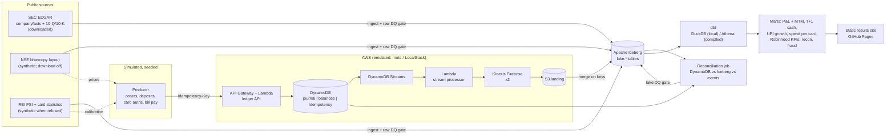

# Broking + cards ledger on AWS (emulated)

[](https://github.com/rohit91jacob/fintech-broking-cards-aws/actions/workflows/ci.yml)
[](https://github.com/rohit91jacob/fintech-broking-cards-aws/actions/workflows/refresh.yml)
[](https://rohit91jacob.github.io/fintech-broking-cards-aws/)
[](LICENSE)
[](DATA_LICENSE.md)


An event-driven, double-entry ledger for a retail **stock broker** (Zerodha / Robinhood style)
and a **credit-card and bill-payments** app (CRED style), built the way it would run on AWS:

**API -> DynamoDB double-entry ledger (idempotency keys, conditional writes) -> DynamoDB
Streams -> Lambda -> Kinesis Data Firehose -> S3 / Apache Iceberg -> dbt (DuckDB locally,
Athena compiled in CI)**, with a reconciliation job proving that ledger balances equal positions,
T+1 settlement, card-fraud rules, and Terraform for the whole stack.

* **Real data where the source allows it.** Robinhood's KPIs and revenue by type from
  **SEC EDGAR** XBRL and filings, downloaded at run time. **NSE** end-of-day prices and **RBI**
  payment statistics (UPI, credit cards outstanding, card spend by bank) are parsed in their
  published file layouts, but neither site serves its files to a client that identifies itself
  honestly, and NSE's Terms of Use prohibit automated collection and the use of its data for
  simulation. The pipeline does not pose as a browser: the NSE download is off by default, a
  refused RBI download is skipped, and both fall back to files already in the raw directory or
  the committed **synthetic** fixtures, which the results site labels as such. See
  [DATA_LICENSE.md](DATA_LICENSE.md#automated-access-what-the-sources-do-with-an-honest-user-agent).
* **Simulated activity, clearly labelled.** Customer orders and card swipes are not public, so
  a seeded simulator generates them: fills at the daily VWAP of the bhavcopy table, card
  spending sized from the RBI table's averages. Every simulated row carries `simulated = true`.
* **Emulated cloud, real code paths.** Every AWS call is a real `boto3` call. Locally and in
  tests it runs on [moto](https://github.com/getmoto/moto) in-process; a CI job runs the same
  code over HTTP against LocalStack (or moto's server). **No AWS account is used anywhere.**
  The Terraform is validated (`fmt`, `validate`, `tflint`, `checkov`), not deployed.
* **Proof.** Robinhood figures match the published earnings releases for every compared metric
  but one (a $322.1 B vs $324 B platform-assets difference between the 10-K and the release);
  the ledger reconciles on 39 + 32 checks; the raw gate fails a run whose NSE window is missing
  any session the exchange calendar expects. See [docs/verification.md](docs/verification.md).

## Results (run of 10 October 2026)

| | |
|---|---|
| Robinhood, Q2 2026 (SEC 10-Q) | **28.4 M** funded customers, **$368.7 B** platform assets, **$21.7 B** net deposits, **$1,308 M** revenue |
| NSE and RBI | **Not downloaded.** The NSE download is off (Terms of Use); the RBI's document server answered with a bot challenge. The run used the synthetic fixtures, so the site's UPI, card and price figures are marked synthetic. |
| Simulated ledger, 28 Sep - 1 Oct 2026 (the fixtures' 4 sessions, synthetic prices) | **2,543** postings, **17** rejected by ledger constraints, **81** idempotent replays, **500** stream records redelivered and de-duplicated; reconciliation **OK** (39 + 32 checks) |
| Full run (`fbc run`, laptop) | 143 s end to end (ingest about 40 s, simulation 86 s, dbt and site the rest); `dbt build`: PASS=78, WARN=1 (`assert_rbi_cards_cross_publication`, expected on the independently generated synthetic workbooks), ERROR=0 |

The UPI and card figures this table showed before (UPI August 2026: 24.51 bn transactions;
124.1 M credit cards) came from the 9 October run of an earlier version that sent a browser
User-Agent to NSE and the RBI. That code is gone; those figures stay in
[docs/verification.md](docs/verification.md) as the record of the parser checks, and this code
cannot reproduce them.

The [results site](https://rohit91jacob.github.io/fintech-broking-cards-aws/) is rebuilt every
weekday evening (IST) by [`refresh.yml`](.github/workflows/refresh.yml).

## Architecture



| Component | What it does | Code |
|---|---|---|
| Sources | SEC companyfacts, XBRL instances (revenue on `srt:ProductOrServiceAxis`), KPI tables; NSE UDiFF bhavcopy and trading calendar; RBI PSI and bank-wise card statistics. Requests carry a descriptive User-Agent; a source that refuses it is skipped (`Refused`), never retried in disguise. | `src/fbc/sources/`, `src/fbc/http.py` |
| Ledger API | API Gateway-style Lambda handler: deposits, orders, T+1 settlements, card authorisations, bill payments, balance reads | `src/fbc/ledger/api.py` |
| Ledger service | One `TransactWriteItems` per posting: idempotency record (`attribute_not_exists`), journal header + legs, `ADD balance` with conditions (no overdraft, no short sale, credit limit). Replays, rejections and key conflicts are distinguished from the cancellation reasons; transient cancellations (transaction conflicts, throttling) return 503 and write nothing, so a retry with the same key is processed normally. | `src/fbc/ledger/service.py`, `model.py` |
| Stream processor | Lambda for DynamoDB Streams: headers -> business events, legs -> ledger entries, `PutRecordBatch` to two Firehose streams, partial batch failures | `src/fbc/ledger/stream.py` |
| Event source mapping (emulated) | Reads shards, invokes the Lambda in batches, re-delivers 5 % of batches to exercise at-least-once delivery | `StreamPoller` in `stream.py` |
| Iceberg sink | Plays Firehose's Iceberg destination: lands S3 JSON lines into Iceberg, partitioned by `business_date`, merged on `(txn_id, leg_no)` / `txn_id` | `src/fbc/lake/sink.py`, `iceberg.py` |
| Simulator | Seeded customers, cards, orders, card swipes, retries, conflicting keys and four fraud scenarios | `src/fbc/sim/` |
| Reconciliation | Trial balance, DynamoDB vs Iceberg, positions, customer cash, clearing obligations, card balances, constraints | `src/fbc/recon.py` |
| Data quality | Raw gate (11 error + 4 warn checks) after ingest, including a complete NSE window: every session the NSE calendar expects in the requested window, `FBC_NSE_SESSION_TOLERANCE` (default 0) missing at most; lake gate (7 checks) after the pipeline; 55 dbt tests on the models | `src/fbc/quality/checks.py`, `dbt/` |
| dbt | staging -> intermediate -> marts, DuckDB over Iceberg locally, Athena target compiled in CI | `dbt/` |
| Infrastructure | Terraform modules: KMS, DynamoDB, S3 + Glue + Iceberg tables, Firehose (Iceberg destination), Lambda + API Gateway + DLQ, Athena, budgets and alarms, GitHub OIDC | `infra/terraform/` |
| Site | Static HTML with inline SVG charts and table views | `src/fbc/report.py` |

## Tech stack

| Layer | Tool (version in `uv.lock`) |
|---|---|
| Language | Python 3.12, managed by uv |
| AWS SDK / emulator | boto3 1.43, moto 5.2 (in-process and HTTP server), LocalStack 2026.09 (CI, optional) |
| Table format | Apache Iceberg via pyiceberg 0.12 (SQLite catalog, local warehouse) |
| Query / transform | DuckDB 1.5.6, dbt-core 1.12, dbt-duckdb 1.11 (iceberg plugin), dbt-athena 1.11 (compile only) |
| Files | pyarrow 26, openpyxl 3.1, requests 2.34 |
| Infrastructure | Terraform 1.16, AWS provider ~> 6.68, tflint 0.64 + AWS ruleset 0.49, checkov |
| Quality | pytest 9, ruff 0.16, pre-commit, gitleaks, actionlint |
| CI / scheduling | GitHub Actions, GitHub Pages |

## Data sources

| Source | What | Licence / terms | Refresh cadence | Known gaps |
|---|---|---|---|---|
| [SEC EDGAR](https://www.sec.gov/edgar/search/) companyfacts + submissions APIs, 10-Q/10-K XBRL instances and HTML | Robinhood (HOOD, CIK 1783879): revenues, revenue by type, funded customers, platform assets (AUC), net deposits, ARPU, Gold subscribers | Public; descriptive User-Agent with a contact e-mail required, <= 10 req/s | Quarterly filings; fetched on every refresh (filings cached) | Quarterly KPIs start in Q1 2024 (older 10-Q layout not parsed); Q3 2022 revenue split does not add up (old XBRL member); Q4 values derived from the 10-K |
| [NSE](https://www.nseindia.com/) capital-market bhavcopy (UDiFF, July 2024 onwards) | Daily OHLC, volume, turnover per stock | Terms of Use prohibit automated data collection and any use of the data for simulation; not licensed for redistribution. **Download off by default** (`FBC_NSE_DOWNLOAD`); the synthetic fixtures are used | (n/a by default) | The archive does not answer non-browser clients (requests time out); UDiFF only; prices only for the 30 most-traded EQ stocks are used |
| [RBI](https://www.rbi.org.in/) Payment System Indicators | UPI, IMPS, NEFT, card payments (volume, value), cards outstanding, payment frauds | RBI website terms: no caching/framing without permission; derived figures published with attribution | Monthly (about 4-6 weeks after month end) | Listing pages are served, but the workbooks come back as a bot challenge to automated clients, so the source is skipped and the synthetic fixtures are used unless the workbooks are already in `raw/rbi/` |
| RBI ATM, Acceptance Infrastructure and Card Statistics | Bank-wise credit cards outstanding and credit/debit card spend | As above | Monthly | As above |
| NPCI UPI product statistics | (not used) | | | Blocked for automated clients (HTTP 403); UPI comes from the RBI series |

Details and attribution: [DATA_LICENSE.md](DATA_LICENSE.md).

## Data model

* **Raw:** `lake.raw_sec_companyfacts`, `raw_hood_revenue_by_type`, `raw_hood_kpis` (real),
  `raw_nse_bhavcopy` (partitioned by trade date), `raw_rbi_psi`, `raw_rbi_card_stats` (real only
  when their files are in the raw directory; otherwise the synthetic fixtures, recorded in
  `runs/ingest_manifest.json`).
* **Ledger (simulated):** `lake.business_events` (one row per request outcome) and
  `lake.ledger_entries` (one row per leg), both partitioned by `business_date`;
  `ledger_balances_snapshot`, `recon_results`, `sim_customers`, `sim_cards`.
* **Marts:** `fct_positions_mtm`, `mart_daily_pnl`, `mart_settlement_cash`,
  `mart_upi_growth_monthly`, `mart_credit_card_spend_per_card`, `mart_robinhood_kpis`,
  `mart_ledger_reconciliation`, `fct_card_fraud_alerts`, `mart_fraud_rule_performance`,
  `mart_sim_card_spend_vs_rbi`.

Double entry: every posting's legs sum to zero per unit (INR, or an ISIN for share quantities).
A buy moves cash from `CUST#c:CASH` to `CCP:CASH_PAYABLE` and fees, and shares from `CCP:SEC` to
`CUST#c:SEC_PENDING`; T+1 settlement moves the shares to `CUST#c:SEC` and pays the clearing
corporation. A card swipe adds to `CARD#k:OUTSTANDING` only if the balance stays within the
limit. Full column list: [docs/data_dictionary.md](docs/data_dictionary.md).

## Quickstart

Prerequisites: [uv](https://docs.astral.sh/uv/) (Python 3.12 is installed by uv). No Docker, no
cloud account. Terraform and tflint are only needed for the infrastructure checks.

```bash
git clone https://github.com/rohit91jacob/fintech-broking-cards-aws && cd fintech-broking-cards-aws
uv sync --frozen --all-extras
cp .env.example .env              # optional; set FBC_SEC_USER_AGENT to your name + e-mail

# Offline, on the committed fixtures (about 3 minutes):
make run-fixtures                 # -> site-fixtures/index.html

# Live sources (downloads about 55 MB from SEC EDGAR; NSE and RBI come from the raw directory
# or, when they have no files there, the synthetic fixtures; about 3 minutes on a laptop):
make run                          # ingest -> simulate -> dbt build -> site/
make reconcile                    # print the reconciliation; exit 4 on any break

make help                         # every target
```

Tests: `make test-unit` (in-process moto), `make test-e2e` (whole pipeline on fixtures plus an
identical rerun), `make test-integration` (HTTP endpoint; LocalStack if `FBC_AWS_ENDPOINT_URL`
is set, otherwise moto's server). Infrastructure: `make infra-check`.

## Local emulator -> real AWS

| Here | On AWS | Notes |
|---|---|---|
| moto `mock_aws` in-process; moto server or LocalStack over HTTP | the same API calls | `FBC_AWS_ENDPOINT_URL` selects the endpoint; code is identical |
| Ledger API called in-process with API Gateway v2 events | API Gateway HTTP API (IAM auth) -> Lambda `fbc.lambdas.api_handler` | `infra/terraform/modules/compute` |
| DynamoDB tables `fbc-dev-ledger-*` | DynamoDB on-demand, PITR, KMS, TTL on idempotency keys | `modules/ledger` |
| `StreamPoller` | Lambda event source mapping (batch 100, bisect, partial failures, DLQ) | |
| Firehose -> S3 JSON lines + `fbc.lake.sink` | Firehose **Iceberg destination** with `unique_keys` upserts into Glue tables | Emulators only support the S3 destination |
| pyiceberg `SqlCatalog` (SQLite) + local directory | AWS Glue Data Catalog + S3 bucket `fbc-dev-lake` | `modules/lake` |
| dbt-duckdb reading Iceberg | dbt-athena on Athena engine v3 (compiled in CI) | `make dbt-athena-compile` |
| GitHub Pages site | (same) | |
| moto's `TransactWriteItems` + a shim | DynamoDB transactions | moto deep-copies every table per transaction; `fbc/aws/moto_patches.py` checks all conditions first, then applies (same all-or-nothing result), tested in `tests/unit/test_moto_patches.py` |

## Cost notes

Nothing here costs money as shipped: the cloud is emulated and CI runs on free GitHub runners.
If the Terraform were applied, the dev stack is pay-per-use: DynamoDB on-demand, Lambda,
Firehose (per GB ingested, Iceberg destination), S3, Athena (per TB scanned, capped at 1 GiB
per query by the workgroup), KMS ($1 a month per key) and CloudWatch Logs. At this project's
volumes (thousands of events a day) that is a few dollars a month, mostly KMS, Logs and
Firehose minimums. Guardrails in `modules/guardrails`: a monthly AWS Budget (default $25,
alerts at 50/80/100 % actual and 100 % forecast), alarms on Lambda errors, stream iterator age,
DynamoDB throttles, DLQ depth and Firehose freshness, reserved concurrency on both functions,
lifecycle rules on every bucket. These are estimates, not measured bills.

## Limitations

* **Emulated, not deployed.** The Terraform passes `validate`, tflint and checkov (23 skips, each
  justified inline) but has never been applied. LocalStack's Firehose has no Iceberg
  destination, so the S3-landing-plus-merge step stands in for it.
* **LocalStack in CI is optional.** Newer LocalStack images need an auth token; without the
  `LOCALSTACK_AUTH_TOKEN` secret the CI emulator job runs the same HTTP test against moto's
  server. The LocalStack variant has not been run (no Docker locally).
* **The simulation is a model.** Brokerage is min(₹20, 0.03 %), statutory charges are not
  modelled, only settled shares can be sold, there are no corporate actions, and the fraud
  rules are scored against the simulator's own labels.
* **Speed.** The default run (about 2,500 postings over the fixtures' 4 sessions) takes a
  couple of minutes because moto serialises every request; real DynamoDB would not be the
  bottleneck.
* **Sources.** Only SEC EDGAR is downloaded by default. NSE's Terms of Use prohibit automated
  collection and the use of its data for simulation, and its archive does not answer an honestly
  identified client, so the broking book is priced at synthetic prices. The RBI's document server
  answers automated clients with a bot challenge, so the UPI and card figures are synthetic unless
  the RBI workbooks are already in `raw/rbi/`. The project does not disguise its client to get
  around either. NPCI is not used (blocked); Robinhood quarterly KPIs start in Q1 2024.
* **Holiday list.** The NSE trading calendar covers 2024-2026 (NSE's published holidays). A
  window in a later year assumes every weekday is a session (the raw gate warns), and a holiday
  NSE declares at short notice fails the gate until it is added to `fbc/sources/nse_calendar.py`.

## Project structure

```text
src/fbc/            cli, config, http, ingest, pipeline, recon, report, lambdas
  aws/              boto3 clients, emulator backend, resource creation, moto shim
  ledger/           model (postings, legs), service (DynamoDB), api, stream (Lambda + poller)
  lake/             iceberg helpers, Firehose-to-Iceberg sink
  sim/              calibration from the raw tables, seeded producer
  sources/          sec, nse (+ nse_calendar), rbi
  quality/          data-quality gates
dbt/                staging / intermediate / marts, tests, profiles (dev, ci, athena)
infra/terraform/    root module + modules/{kms,ledger,lake,streaming,compute,analytics,guardrails,ci_oidc}
tests/              unit, e2e, integration, fixtures (real SEC excerpts, synthetic NSE/RBI layouts)
scripts/            fixture builders, Lambda packaging
docs/               data_dictionary.md, runbook.md, verification.md
.github/workflows/  ci, refresh (weekdays), keepalive, deploy (manual, OIDC, gated)
```

## License

Code: MIT. Data: see [DATA_LICENSE.md](DATA_LICENSE.md). Not investment advice; not affiliated
with Robinhood, NSE, RBI, NPCI, Zerodha or CRED.
